# Sample questions and results

Dollar amounts are written as USD so they render on GitHub and in the Google Doc.

Ten questions per industry for the Tableau Next analytics agent (70 in total), plus what happened when 15 of them were run against the semantic models.

**Google Doc version (with the same charts and notes):** [Cumulus Tableau Next: sample questions and results](https://docs.google.com/document/d/1-jTewKieCs9LpO4OyayeAP0K2x8PzaXeZ-WflnmY1vc/edit)

Talk track based on these results: [TALK_TRACK.md](TALK_TRACK.md) | [Google Doc](https://docs.google.com/document/d/1YrYKeli1kvOCJNczs_ZHAkeDhqqWGD6qh9t9p8G02y8/edit)

## How the results were produced

- Run on 2026-11-09 against org `sdo1010` through the Semantic Query API (`semantic-engine/gateway`), not through the analytics agent. The hosted Tableau Next MCP needs an External Client App that is not set up yet, so the agent itself has not been tested. See `mcp/README.md` for the setup steps.
- 3 questions per demo for the 5 demos that were built and queried at the time: Retail Banking, Wealth, Asset Management, Commercial Banking and Insurance. Financial Advisors and Lending have since been built (2026-11-09) but were not queried.
- This checks that the data and fields can answer each question. It does not test how the agent interprets the wording.
- Charts are drawn from the returned rows. "Chart fit" is a judgement of how well each result reads as a chart.

## What went well

- 14 of 15 queries ran as written on the first attempt, and row counts matched the loaded data (for example, case counts by channel add up to 5,296).
- Two demo stories show up clearly in the data: Wealth churned households had 9.1 interactions against 35.0 for retained households (about 3.8x fewer), and Commercial onboarding took 43.8 days without treasury products against 22.3 days with (about 2x).
- Ranked-bar questions (AUM, pipeline, credit exposure, paid claims, FNOL channel) gave clear charts with 4 to 8 categories.

## What did not go well

- **Date filter rejected.** The Retail Banking dispute query with a `CreatedDate >= 2026-05-01` filter failed (`Cannot find field: filters in message`). The Postman collection's filter example uses that shape, so it is likely wrong. The question was re-run without the date filter.
- **Retail dispute spike not visible.** Without the date filter, the top 10 branches sit between 42 and 54 dispute cases and BR-003 is not standing out.
- **Insurance hail story is weaker than described.** Catastrophe claims took 25.8 days against 20.5 (about 26% longer), not the 40% in the demo narrative.
- **Flat charts.** Retail deposits by region (USD 21.4M to USD 24.0M) and Retail CSAT, Agentforce vs human (within 0.12 on every case type), show little.
- **Not tested:** the analytics agent, dashboard rendering in the UI, and any question that names a person or account.

## Questions by industry

### Retail Banking

Semantic model template: `Cumulus_Retail_Banking_SDM` | Persona: Branch service manager

1. Which branches have the most Card Dispute cases since May 2026, and how does that compare to the prior three months?
2. What is our first-contact resolution rate by channel this quarter?
3. Show CSAT by case type for cases handled by Agentforce versus human agents.
4. How many households in the Premier segment hold only one product?
5. What is the total deposit balance by region, and which region grew fastest over the last 12 months?
6. List the top 10 households by balance in branch BR-003 that have had a Fee Inquiry case.
7. What is the average handle time for Voice cases versus Chat cases?
8. How many disputed transactions were there in August 2026 and what was their total amount?
9. Which case sub-types have the lowest CSAT?
10. Summarize Lauren Bailey's accounts, recent transactions and open cases.

### Wealth

Semantic model template: `Cumulus_Wealth_SDM` | Persona: Advisor team lead

1. What is total AUM by advisor, and who grew the most this year?
2. Compare interaction frequency for churned versus retained households.
3. Which households have had fewer than two interactions in the last quarter and more than 1M USD AUM?
4. Show net new assets by month for the last 12 months.
5. What percentage of financial goals are At Risk or Off Track, by goal type?
6. What is the asset allocation of Growth-profile households versus Conservative?
7. Which advisors have the highest client retention?
8. Summarize the Ashford Family Office relationship: accounts, custodians, inflows.
9. How much revenue is at risk from households that churned in 2026?
10. Which households have a Retirement goal with a target date before 2030 that is under 50% funded?

### Asset Management

Semantic model template: `Cumulus_Asset_Management_SDM` | Persona: Institutional client service lead

1. What is our SLA attainment by request type for the last two quarters?
2. Do Reconciliation requests breach SLA more often at quarter-end?
3. What is AUM by strategy and how have net flows trended by month?
4. Which clients drove the largest outflows in 2026?
5. What is the deal win rate by source and by strategy?
6. Show the pipeline by stage with total amount.
7. Which client service associates carry the most open requests?
8. What is the average cycle time for Onboarding Document requests?
9. Which Strategic-tier clients have open High-priority requests?
10. What is the fee revenue run-rate (AUM × fee rate) by client type?

### Insurance

Semantic model template: `Cumulus_Insurance_SDM` | Persona: Claims service manager

1. What is the loss ratio by line of business for the last 12 months?
2. How did the June 2026 hail catastrophe affect claims cycle time in Colorado, Utah and Arizona?
3. How many claims are open and how are they aging?
4. What is the renewal rate by producer type?
5. Which adjusters have the highest claims workload right now?
6. What share of claim-related service cases were handled by Agentforce, and what was CSAT?
7. Show policies in force by carrier and state.
8. What is the average paid amount versus reserve by claim type?
9. Which FNOL channel is growing fastest?
10. Summarize Elena Ruiz's homeowners policy and any claims.

### Commercial Banking

Semantic model template: `Cumulus_Commercial_SDM` | Persona: Relationship manager desk lead

1. What is the deal pipeline by stage and product?
2. Do clients without treasury products take longer to onboard?
3. Which credit facilities are above 80% utilization or over their covenant maximum?
4. What is treasury product penetration by segment?
5. Which referral sources convert best?
6. Show relationship profitability by industry.
7. Which business accounts have the most ACH file rejection cases?
8. What is the average onboarding cycle time for sFTP / ACH setups in 2026?
9. List Middle Market clients with a Watch or Substandard risk rating.
10. Summarize the Meridian Logistics relationship: facilities, treasury products, onboarding and cases.

### Financial Advisors

Semantic model template: `Cumulus_Advisors_SDM` | Persona: Financial advisor

1. Which of my clients have a life event with no follow-up within 14 days?
2. What is my book of business by life stage and risk profile?
3. How many activities per household did I log last quarter versus my peers?
4. Which referrals are still New after more than 7 days?
5. Show goal attainment status by goal type across my book.
6. Which households have not had an annual review in the last 12 months?
7. What is the total opportunity value of life events detected by Agentforce signals?
8. Rank advisors by referral conversion rate.
9. Which clients with more than 1M USD AUM hold fewer than three products?
10. What is the average days-to-first-contact for referrals by source?

### Lending

Semantic model template: `Cumulus_Lending_SDM` | Persona: Loan operations manager

1. What is our pull-through rate by product and channel?
2. Which stage accounts for the largest share of cycle time?
3. How does time-to-close for digital applications compare to branch applications?
4. What is the abandonment rate for digital applications by month?
5. Which loan officers funded the most volume this year?
6. How many applications are in Document Collection with outstanding documents?
7. What is the average interest rate by credit score band?
8. Show application volume and funded volume by month.
9. Which case types are most common for applications in Underwriting?
10. What share of lending service cases were handled by Agentforce, and what was CSAT?

## Results of the 15 queries run

### Retail Banking

**Which branches have the most Card Dispute cases? (all dates; date filter not applied)**

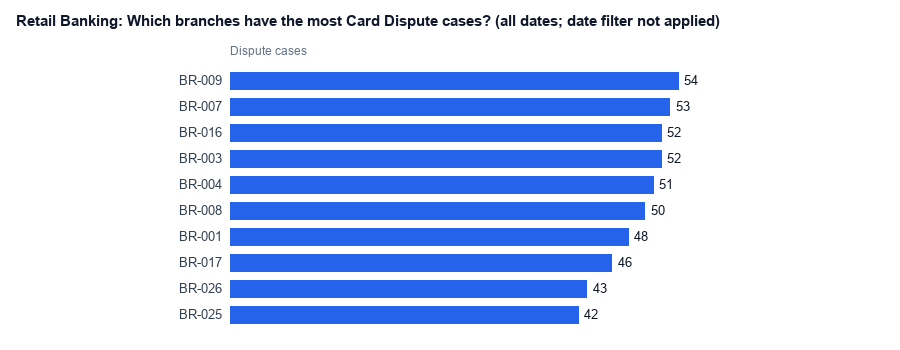

- Finding: Flat. All top branches sit at 42-54 cases, so the May fee-change spike for BR-003 / BR-011 does not show without a date filter.
- Chart fit: Medium. Ranked bars suit it, but the answer is a non-answer.

**Show CSAT by case type, Agentforce vs human**

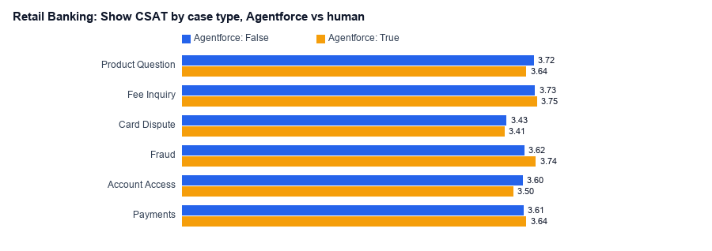

- Finding: Agentforce and human CSAT are within 0.12 points on every case type. Agentforce is higher on Fraud, Fee Inquiry and Payments, lower on the other three.
- Chart fit: Medium. Grouped bars work, but all bars look the same length.

**What is total deposit balance by region?**

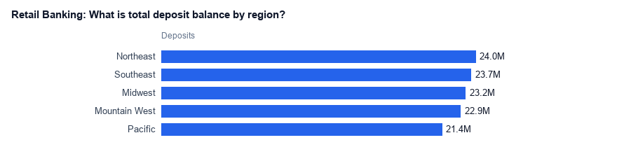

- Finding: Evenly spread: USD 21.4M to USD 24.0M per region, Northeast highest.
- Chart fit: Low. Five near-equal bars show no story.

### Wealth

**What is total AUM by advisor?**

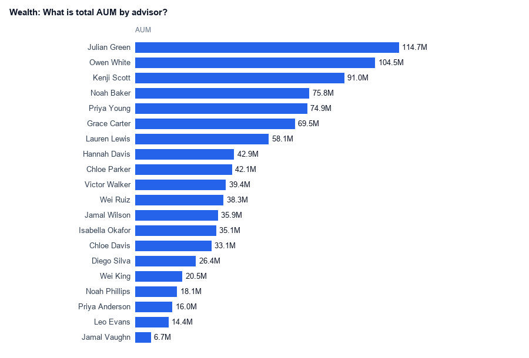

- Finding: Wide spread across the top 20 advisors: AUM ranges from USD 7M to USD 115M, with the top two above USD 100M.
- Chart fit: High. Ranked bars show the spread at a glance.

**Compare interactions per household, churned vs retained**

- Finding: Churned households averaged 9.1 interactions against 35.0 for retained, about 3.8x fewer. This is the headline Wealth story, and the data supports it.
- Chart fit: High. Two bars, one clear gap.

**What are goal statuses by goal type?**

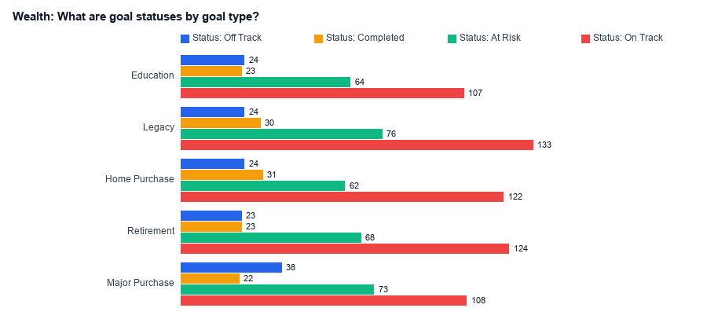

- Finding: Shows the mix of On Track, At Risk, Off Track and Completed per goal type.
- Chart fit: Medium. Too many rows for grouped bars; a stacked bar would read better.

### Asset Management

**SLA breaches by request type**

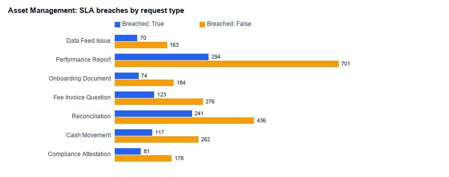

- Finding: Performance Report has 294 breaches out of 995 requests (30%). Needs the quarter-end split to test the demo story.
- Chart fit: Medium. Grouped bars give counts, not a breach rate.

**What is AUM by strategy?**

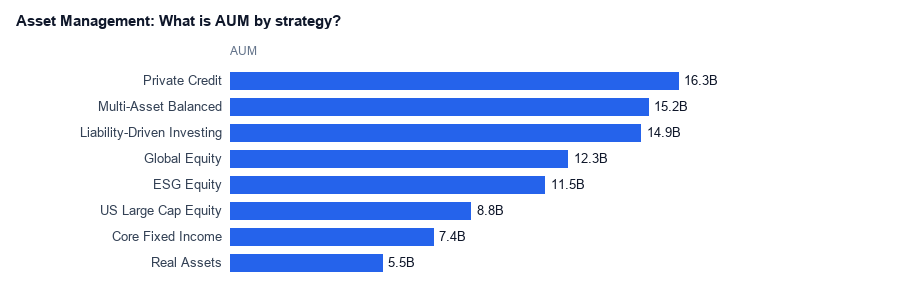

- Finding: Private Credit (USD 16.3B) and Liability-Driven Investing (USD 14.9B) lead.
- Chart fit: High. Ranked bars with 8 clear categories.

**Pipeline by stage with total amount**

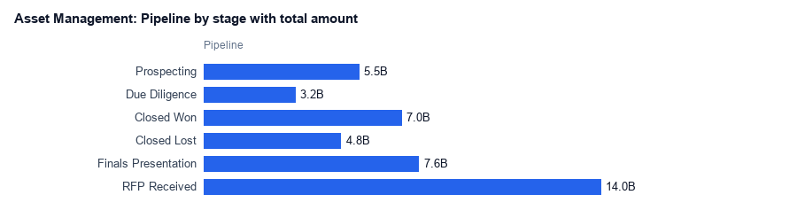

- Finding: RFP Received holds the largest pipeline (USD 14.0B), then Finals Presentation (USD 7.6B).
- Chart fit: High. Reads like a funnel when ordered by stage.

### Commercial Banking

**Do clients without treasury products take longer to onboard?**

- Finding: Yes. 43.8 days without treasury products against 22.3 days with, about 2x. This matches the demo story.
- Chart fit: High. Two bars, one clear gap.

**Deal pipeline by stage**

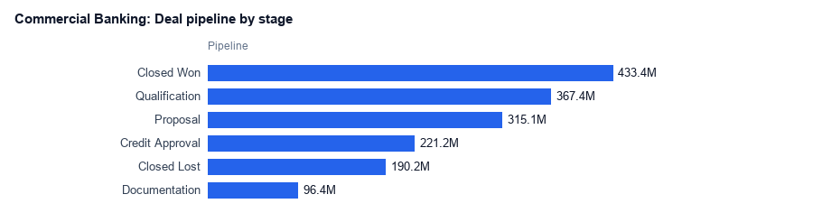

- Finding: Closed Won is the largest stage (USD 433M), then Qualification (USD 367M).
- Chart fit: High. Ranked bars with 6 stages.

**Credit exposure by risk rating**

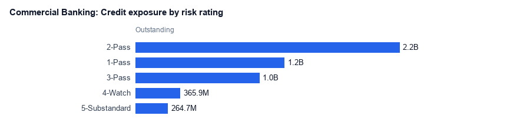

- Finding: 2-Pass carries USD 2.2B. Watch and Substandard together total about USD 630M.
- Chart fit: High. Bars ordered by rating show risk concentration.

### Insurance

**Paid claims by line of business**

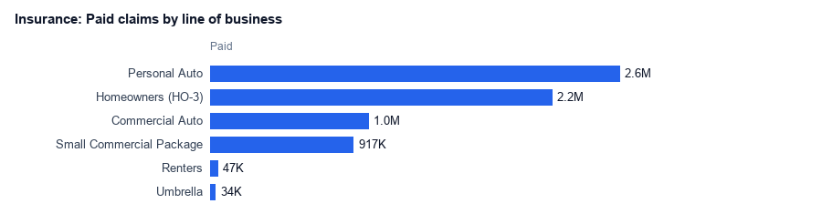

- Finding: Personal Auto (USD 2.6M) and Homeowners (USD 2.2M) account for most paid claims.
- Chart fit: High. Ranked bars, clear leaders.

**Average claim cycle time by catastrophe code**

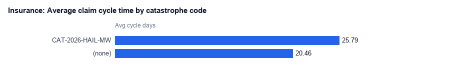

- Finding: Hail catastrophe claims take 25.8 days against 20.5 for the rest, about +26%. The demo story says +40%, so the data does not fully back it.
- Chart fit: Medium. Two bars, but a small gap.

**Which FNOL channel has the most claims?**

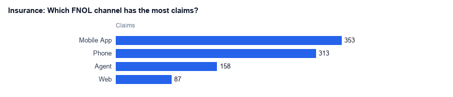

- Finding: Mobile App leads with 353 claims, just ahead of Phone (313).
- Chart fit: High. Four bars, clear ranking.

## Next steps

- Set up the External Client App (`mcp/README.md`) and run all 70 questions through `analyze_data` to compare the agent's answers and charts with the above.
- Find the right filter syntax for the Semantic Query API and re-run the date-filtered questions.
- Query Financial Advisors and Lending once those apps are confirmed built.
